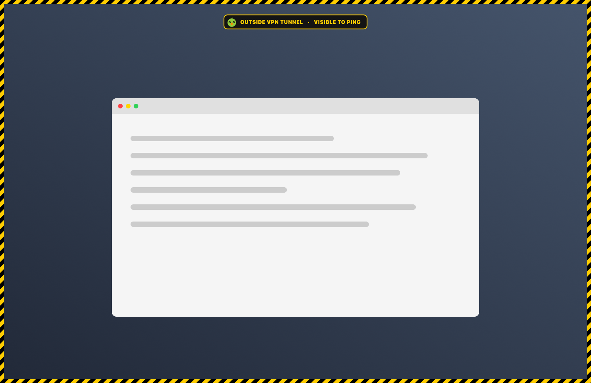

<p align="center"></p>

# NetCanari

*Canari* is French for canary, as in the canary in the coal mine: it warns you before
you notice the danger. NetCanari watches the network you are on.

A small macOS menu bar app that puts a yellow-and-black hazard frame around every
screen when your Mac is exposed on a Wi-Fi network you do not trust.



<sub>The frame and banner are the app's real rendering (`canari --snapshot`), composited
over a placeholder desktop.</sub>

> **Personal project.** Built for one Mac, tested on one configuration (macOS 27,
> Apple Silicon, Tailscale with an exit node). No warranty, no support promised. It
> warns you; it does not block traffic. Read the [limits](#limits) before relying on it.

## What it does

On any network that is not in your trusted list, the frame appears when either
check fails, and a banner names which:

- `OUTSIDE VPN TUNNEL`: your default traffic is not going through a VPN (any VPN, or
  the specific one you chose: a Tailscale exit node, WireGuard, IPsec…).
- `VISIBLE TO PING`: the macOS firewall's stealth mode is off, so the Mac answers
  pings and port scans.

The frame is click-through, sits above full-screen apps, and is excluded from
screenshots and screen sharing.

A companion script, `stealth-auto.sh`, turns stealth mode on everywhere except on
trusted networks. NetCanari runs it each time the Mac moves between a trusted network
and anywhere else.

## The canary's menu

A canary icon in the menu bar shows that NetCanari is running. It turns green with
crossed-out eyes when a check fails, or when no trusted network has been set up yet.
Its menu has:

- **Current state**: "Protected", "Exposed: …", "Trusted network: name" or "Offline".
- **Wi-Fi**: the name of the current network.
- **Trust This Network…**: adds the network the Mac is connected to, under its Wi-Fi
  name. "Stop Trusting This Network" does the opposite.
- **Trusted Networks**: the list; click a network to remove it.
- **Accepted Tunnel**: "Any VPN", or one of the VPNs configured on the Mac. With a
  specific VPN, any other tunnel still triggers the frame.
- **Launch at Login**: creates or removes the LaunchAgent.
- **Quit**: the app comes back at the next login (or right away if it crashes).

On a trusted network the frame does not appear and stealth mode is turned off, so
only trust networks you control.

## How it works

| State | Detection | Frame |
|---|---|---|
| Offline | no default route | no |
| Trusted network | gateway **and** router MAC address are in the list | no |
| Elsewhere, protected | default traffic in the accepted tunnel, stealth mode on | no |
| Elsewhere, exposed | either check fails | yes |

A network is recognised by its gateway and its router's MAC address, not by its
Wi-Fi name: a name takes seconds to imitate. The name is only a label for humans. A
consequence is that you can only trust the network you are connected to, not pick
one from a list of names.

Everything is read from the macOS configuration store (`SCDynamicStore`):

- the router's MAC (`ARPResolvedHardwareAddress`). `arp` is no use here: when it is
  launched by a program not signed by Apple, it returns no entries;
- the network service carrying the default traffic. "Any VPN" accepts a `utun`,
  `ipsec` or `ppp` interface; a specific VPN is matched by its service identifier.

A VPN that only carries part of the traffic (Tailscale without an exit node, a
split-tunnel VPN, a per-app VPN) does not count as protection.

NetCanari subscribes to macOS network changes (`NWPathMonitor`, `SCDynamicStore`) and
re-evaluates one second after the last event. A stealth mode change emits no network
event, so `stealth-auto.sh` sends `SIGUSR1` to the app, and a fallback re-evaluation
runs every 60 seconds.

## Install

Requires macOS 13 or later and the Xcode command line tools (`swiftc`).

```sh
./install.sh
```

The script builds `~/Applications/NetCanari.app` (no Dock icon), creates the
`~/.local/bin/canari` command, installs `stealth-auto.sh` and enables launch at
login (a user LaunchAgent, `local.canari`). It does not use `sudo`.

On first launch macOS asks for location access. That is the condition for reading
the Wi-Fi name, shown in the menu and used as the name of trusted networks. The
location itself is never used, and declining breaks nothing else. The app is ad hoc
signed, so macOS may ask again after a rebuild.

Then:

1. At home, open the canary's menu and choose "Trust This Network…".
2. Allow the stealth mode toggle without a password (two exact commands):
   ```sh
   sudo install -m 0440 -o root -g wheel ~/.local/bin/stealth-auto.sudoers /etc/sudoers.d/stealth-auto
   ```

`stealth-auto.sh` can also run a command of your choice on each change, one for
trusted networks and one for everywhere else: see `ON_TRUSTED` and `ON_UNTRUSTED` in
[`config.example`](config.example). A typical use is disconnecting the VPN at home
and reconnecting it elsewhere.

Step 2 is only needed for the automatic stealth mode; the frame works
without it. The icon can be moved in the menu bar with Cmd-drag; its position is
remembered.

## Files

| File | Purpose |
|---|---|
| `~/.config/canari/trusted` | trusted networks (`gateway mac name`), managed by the menu |
| `~/.config/canari/tunnel` | required VPN (`id<TAB>name`), managed by the menu; absent = any |
| `~/.config/canari/config` | optional: `WIFI_INTERFACE` if it is not `en0`, and the `ON_TRUSTED` / `ON_UNTRUSTED` hooks |
| `~/Library/Logs/stealth-auto.log` | log of stealth mode toggles |

## Command line

```sh
canari --status           # current state
canari --list             # trusted networks
canari --tunnels          # configured VPNs, * marks the accepted tunnel
canari --trusted          # exit 0 if the current network is trusted, 1 if not, 2 if not ready
canari --login on|off     # launch at login
canari --demo             # show the alert state for 8 s (frame, banner, menu bar icon)
canari --snapshot f.png   # render the frame to a PNG without showing anything
stealth-auto.sh --dry-run # what the toggle would do, without changing anything
```

## Footprint

Measured on an Apple Silicon MacBook Pro: a binary of about 210 KB, 12 MB of memory,
0% CPU at rest. No dependencies beyond system frameworks, and one Swift file.

## Limits

- It is a warning, not a kill switch: traffic keeps flowing while the frame is up.
- The tunnel is judged by the default route; the public IP is not checked.
- A router's MAC address can be spoofed by someone who knows it.
- The network is read on the Wi-Fi interface only (not Ethernet).
- Only tested with Tailscale. Other VPNs should work as long as macOS reports them
  as the primary network service, but that is untested.
- The interface is in English only.

## Uninstall

```sh
launchctl bootout gui/$(id -u)/local.canari
rm -r ~/Library/LaunchAgents/local.canari.plist ~/Applications/NetCanari.app ~/.local/bin/canari ~/.local/bin/stealth-auto.* ~/.config/canari
sudo rm /etc/sudoers.d/stealth-auto
```

## License

[MIT](LICENSE)
